# Shaderous

[](https://arxiv.org/abs/2611.31162)
[](https://hub.valency.io/works/W_e4sja6m3)

<p align="center">
<a href="docs/img/gallery/kelvin-helmholtz.jpg">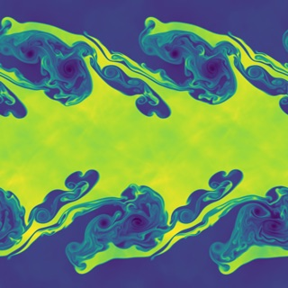</a> <a href="docs/img/gallery/tidal-disruption-dipole.jpg">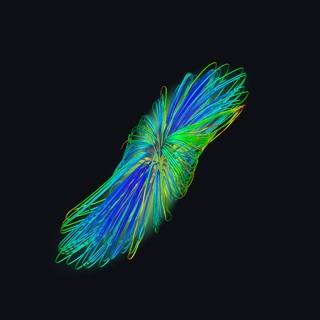</a> <a href="docs/img/gallery/rayleigh-taylor.jpg">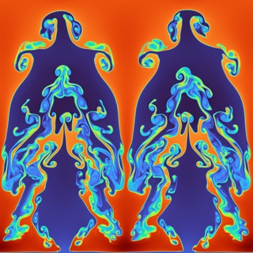</a> <a href="docs/img/gallery/taylor-green.jpg">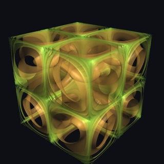</a> <a href="docs/img/gallery/shock-bubble.jpg">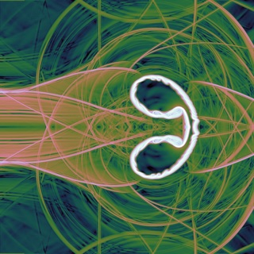</a> <a href="docs/img/gallery/sub-chandra.jpg">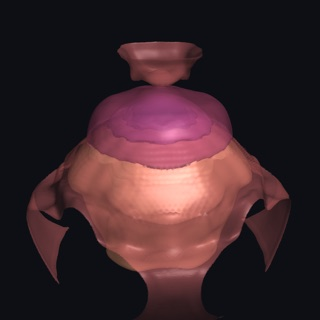</a>
<a href="docs/img/gallery/orszag-tang.jpg">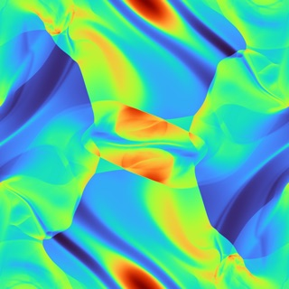</a> <a href="docs/img/gallery/driven-turbulence.jpg">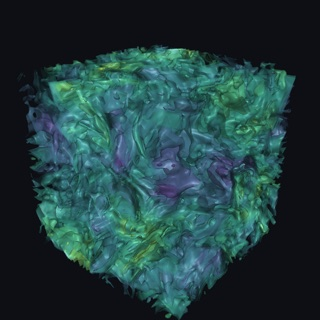</a> <a href="docs/img/gallery/thermal-instability.jpg">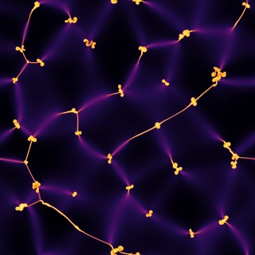</a> <a href="docs/img/gallery/tidal-disruption.jpg">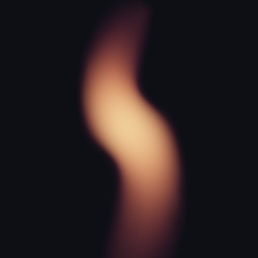</a> <a href="docs/img/gallery/cylinder-wake.jpg">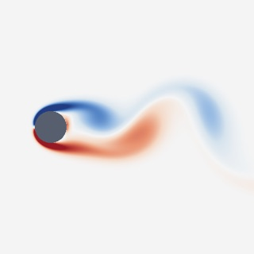</a> <a href="docs/img/gallery/mri-box.jpg">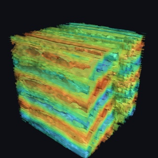</a>
<a href="docs/img/gallery/detonation-cellular.jpg">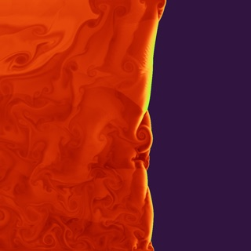</a> <a href="docs/img/gallery/wd-collision-burning.jpg">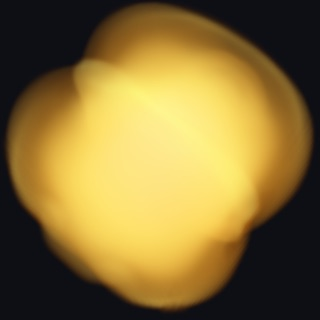</a> <a href="docs/img/gallery/kelvin-helmholtz-mhd.jpg">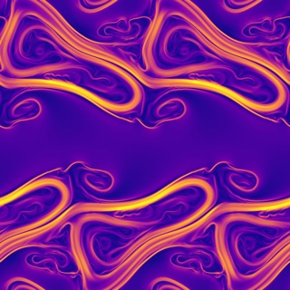</a> <a href="docs/img/gallery/isothermal-collapse.jpg">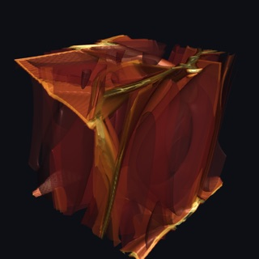</a> <a href="docs/img/gallery/binary.jpg">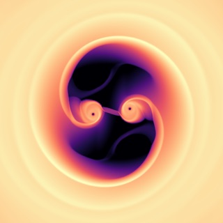</a> <a href="docs/img/gallery/alfven-collision.jpg">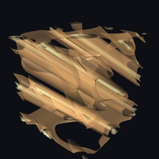</a>
<a href="docs/img/gallery/forward-step.jpg">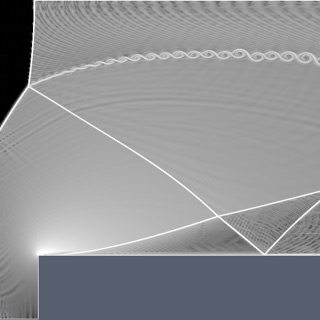</a> <a href="docs/img/gallery/mri-disk.jpg">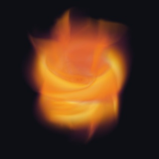</a> <a href="docs/img/gallery/mhd-rotor.jpg">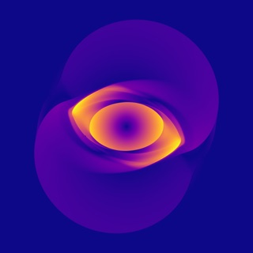</a> <a href="docs/img/gallery/tidal-disruption-full.jpg">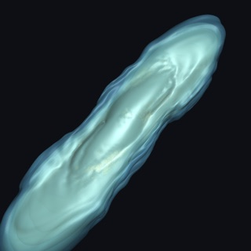</a> <a href="docs/img/gallery/kelvin-helmholtz-he-h.jpg">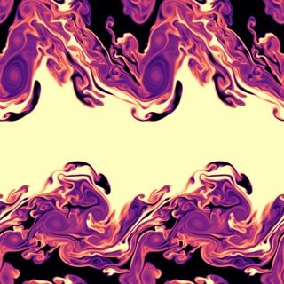</a> <a href="docs/img/gallery/driven-turbulence-mhd.jpg">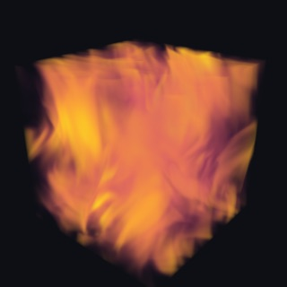</a>
<a href="docs/img/gallery/island-coalescence.jpg">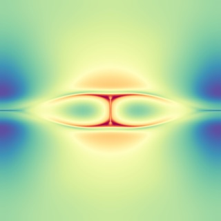</a> <a href="docs/img/gallery/wd-collision.jpg">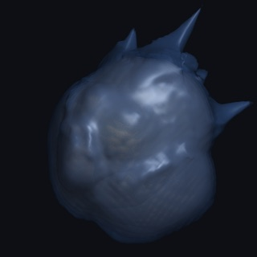</a> <a href="docs/img/gallery/shear-layers.jpg">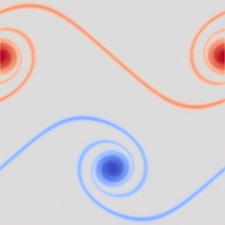</a> <a href="docs/img/gallery/polytrope-dipole.jpg">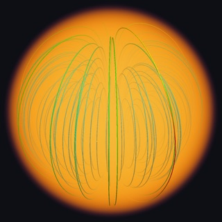</a> <a href="docs/img/gallery/mhd-blast.jpg">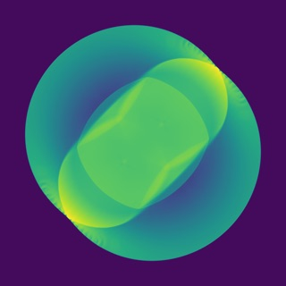</a> <a href="docs/img/gallery/alfven-packets.jpg">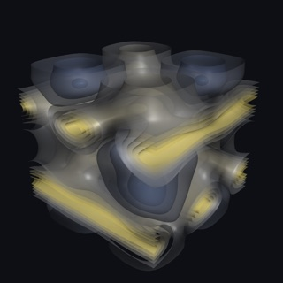</a>
<a href="docs/img/gallery/detonation-pulsating.jpg">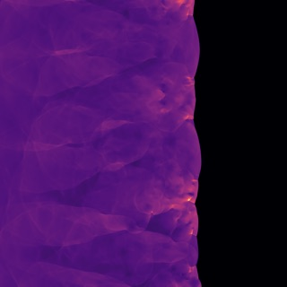</a> <a href="docs/img/gallery/tidal-disruption-n3-full.jpg">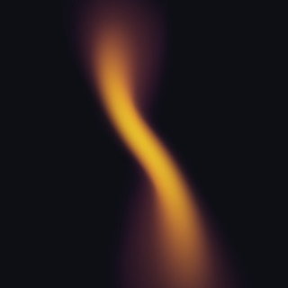</a> <a href="docs/img/gallery/radiation-shadow.jpg">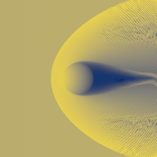</a> <a href="docs/img/gallery/sedov.jpg">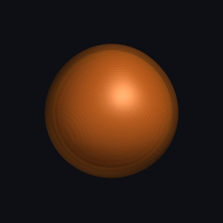</a> <a href="docs/img/gallery/x-point.jpg">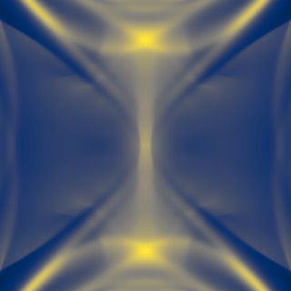</a> <a href="docs/img/gallery/blast-axisymmetric.jpg">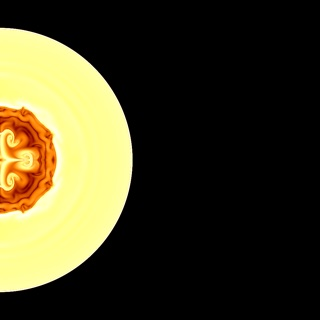</a>
</p>

**Compressible gas dynamics, ideal MHD and radiation transport, with shocks, gravity, nearly
incompressible liquids and adaptive mesh refinement, running entirely on your GPU inside a web browser. For physics research and teaching.**

**▶ Open it: https://guillochon.github.io/shaderous/** · Validation suite:
[validate.html](https://guillochon.github.io/shaderous/validate.html) · Requires a browser
with WebGPU (current Chrome, Edge, Firefox or Safari).

## Quick start

**In the browser (no install).** Open the [live site](https://guillochon.github.io/shaderous/).
It starts with a 2D Kelvin-Helmholtz instability. Choose another problem from the left
panel: shock tubes, blasts, instabilities, a supersonic wind tunnel, liquids at low Mach number
(a vortex street behind a cylinder, a lid-driven cavity), detonations, radiation (a clump's
shadow, radiative shocks), magnetized
flows, and astrophysical flows such as stars, white dwarf collisions, tidal disruptions,
accreting binaries, Roche lobe overflow, a common envelope, and planets and the Moon-forming impact. Drag in the
view to rotate it, and use the brushes to stir, heat or add gas, or, in a magnetized run, to strengthen or drag the field. The address bar always describes the current setup, so copying it (or pressing
**Share**) gives someone else the same run. **Record** saves the run as an MP4 movie with a
color bar, axes and the simulation time drawn on it, **Screenshot** (under Movie and
screenshot) saves a slice, a projection or a 2D run as a PNG at the grid's own resolution, one
pixel per cell, **Export state** saves an `.athdf` file,
and checkpoints (under Time) save one at regular intervals. **Setup…** opens every setting of
the simulation in one dialog, where a run can be assembled from parts (point masses, stars,
disks, gas regions, obstacles, a magnetic field) and saved as a file: each preset is such a
file ([docs/setups.md](docs/setups.md)). Some examples:

- [Rayleigh-Taylor instability](https://guillochon.github.io/shaderous/?problem=rayleigh-taylor)
- [A Mach 3 wind tunnel with a step](https://guillochon.github.io/shaderous/?problem=forward-step)
- [Sedov-Taylor blast in 3D](https://guillochon.github.io/shaderous/?problem=sedov&dim=3&n=128)
- [A star torn apart by a black hole, on an adaptive mesh](https://guillochon.github.io/shaderous/?problem=tidal-disruption-full)
- [Thermal instability of the interstellar medium](https://guillochon.github.io/shaderous/?problem=thermal-instability)
- [A binary accreting from a circumbinary disk](https://guillochon.github.io/shaderous/?problem=binary)
- [The Orszag-Tang vortex, a classic of magnetohydrodynamics](https://guillochon.github.io/shaderous/?problem=orszag-tang)
- [A magnetized star torn apart by a black hole, with its field lines](https://guillochon.github.io/shaderous/?problem=tidal-disruption-dipole)
- [A cellular detonation front](https://guillochon.github.io/shaderous/?problem=detonation-cellular)
- [A vortex street behind a cylinder, in a nearly incompressible liquid](https://guillochon.github.io/shaderous/?problem=cylinder-wake)
- [The shadow of an opaque clump in a beam of radiation](https://guillochon.github.io/shaderous/?problem=radiation-shadow)
- [A sub-Chandrasekhar Type Ia supernova: a white dwarf's helium shell detonates, then its core](https://guillochon.github.io/shaderous/?problem=sub-chandra)
- [The Moon-forming impact: Theia strikes the proto-Earth](https://guillochon.github.io/shaderous/?problem=moon-forming-impact)
- [A common envelope: a star spirals into a red giant's envelope](https://guillochon.github.io/shaderous/?problem=common-envelope)
- [Roche lobe overflow: a star pours gas through L1 onto a black hole](https://guillochon.github.io/shaderous/?problem=roche-lobe-overflow)
- [Roche lobe overflow between two resolved stars](https://guillochon.github.io/shaderous/?problem=roche-lobe-overflow-stars)

**From an AI agent, or the command line.** The npm package runs the simulator in headless
Chrome on your GPU (it needs Node 20+ and Chrome). `npx -y shaderous mcp` is an
[MCP server](docs/headless.md#mcp-server) that gives an agent tools to load a setup, run it, read
numbers back and look at it. For Claude Code, install the plugin, which adds the server and a
skill that teaches Claude to build setups from a description in words:

```bash
claude plugin marketplace add guillochon/shaderous
```

```bash
claude plugin install shaderous@shaderous
```

Or add only the server: `claude mcp add shaderous -- npx -y shaderous mcp`.

Other clients (Claude Desktop, Cursor, VS Code, Codex, Gemini CLI) take the same command:

```json
{ "mcpServers": { "shaderous": { "command": "npx", "args": ["-y", "shaderous", "mcp"] } } }
```

`npx shaderous run --problem sedov --dim 2 --n 512 --png` runs a setup to the end and writes
its outputs to a folder ([docs/headless.md](docs/headless.md)).

**Locally.** Running it yourself needs Node 20+.

```bash
git clone https://github.com/guillochon/shaderous.git
```

```bash
cd shaderous && npm install
```

```bash
npm run dev
```

Then open http://localhost:5183 (the validation suite is at
http://localhost:5183/validate.html). `npm test` runs the unit tests in Node,
`npm run test:gpu` runs the validation suite and the scripting tests on your GPU through
Playwright, and `npm run test:headless` checks the command-line runner and the MCP server.

## What it is

Shaderous is a three-dimensional finite-volume code for compressible gas dynamics, ideal
magnetohydrodynamics and radiation hydrodynamics, which also runs nearly incompressible liquids. Every
fluid and gravity computation runs in WGSL compute shaders through WebGPU, so it runs on GPUs
from any vendor, from a phone to a workstation, with nothing to install. Nothing in the
scheme is specific to astrophysics: it solves the compressible Euler equations, or the ideal
MHD equations, with optional gravity, diffusion, heating, cooling, radiation transport and nuclear burning, and fits a fluid dynamics course as well as an
astrophysics one. The problems that ship with it are mostly astrophysical because they test
every part of the code at once: strong shocks, self-gravity, stars that must stay in
hydrostatic balance, accreting point masses, cooling, and matter as far from an ideal gas as
degenerate electrons. It uses the methods of production simulation codes:

- an unsplit MUSCL-Hancock scheme with third-order reconstruction and HLLC fluxes;
- a multigrid Poisson solver with periodic or isolated boundaries;
- block-structured adaptive mesh refinement with per-block timesteps;
- ideal MHD by van Leer integration with constrained transport and HLLD or HLLE fluxes, on the
  uniform grid and the adaptive mesh alike, keeping div B at round-off through refinement and
  per-block timesteps, with field lines drawn in 2D and 3D;
- point masses with sinks, which can also be the cores of giant stars;
- equations of state from an ideal gas to degenerate electrons and ionizing hydrogen, and for
  burning white dwarf matter a tabulated electron-positron gas at any degeneracy and
  temperature, in the manner of the Helmholtz equation of state, and for gas from
  molecular clouds to stellar envelopes a tabulated mixture of hydrogen and helium with H₂,
  its dissociation and the ionization of both;
- rock, iron alloy and water from their published ANEOS models, with melting and vaporization,
  one material or two in a cell: planets with iron cores under rock mantles, and their
  collisions;
- nearly incompressible flow: a weakly compressible liquid on the same explicit scheme, and for
  it an implicit pressure solve (multigrid) that takes the timestep from the flow speed instead
  of the sound speed, on the uniform grid and the adaptive mesh;
- gray radiation transport with the M1 closure, in the gas's frame and with a reduced speed of
  light: radiation that diffuses through opaque gas, streams through thin gas and casts shadows,
  heats and pushes the gas, on the uniform grid and the adaptive mesh;
- optically thin cooling, viscosity, thermal conduction, and species carried with the gas,
  whose composition (and each species' own gamma) sets the equation of state cell by cell;
- nuclear burning from fuel to ash by a single-step Arrhenius reaction, with steady (ZND)
  detonations as initial conditions and as references, and of the 13-isotope alpha chain
  (aprox13's reactions) by a small neural network trained on the reference network's burns
  (tools/burn), for carbon-oxygen detonations, burning white dwarf collisions and the double
  detonation of a sub-Chandrasekhar white dwarf.

WebGPU is a graphics interface, and fitting a conservative scheme into it shaped the design.
No face flux is ever stored: the two cells that share a face compute bit-identical fluxes, so
mass, momentum and energy are conserved to round-off even across refinement and time-step
boundaries. Ghost cells are computed as they are loaded, never exchanged. The timestep and the
scheduling of blocks happen on the GPU, so a step never waits for the CPU. Everything is single
precision, as WGSL requires. A well-balanced reconstruction and initial states settled against
the grid's own potential still hold stars and atmospheres in hydrostatic balance.

Shaderous is meant for teaching, for exploring a problem before committing to a production
run, and for sharing a reproducible setup as a link. It is not a replacement for codes such as
Athena++, FLASH or RAMSES: it runs on one GPU, within the memory the browser allows, and its
radiation transport is gray (M1), and on the adaptive mesh takes one timestep for all blocks. On a 24 GB card that memory goes a long way: the largest run so far,
a magnetized accretion disk at 512^3 with three levels of refinement, held 16.8 GB of GPU
memory (about 24 million cells) on an RTX 4090 and ran an orbit in 14 minutes
([details](docs/headless.md#largest-run-so-far)). The state can be exported as Athena++-style HDF5 that
[yt](https://yt-project.org/) reads directly, and a run can be recorded as an MP4 movie. A
suite of 223 validation tests runs on your own GPU, in the browser or from the command line.
Scripts and AI agents can drive the simulator too: through a JavaScript API in the page, a
command-line runner for single runs and parameter sweeps, or an MCP server.

## Documentation

| | |
|---|---|
| **[Teaching guide](docs/teaching.md)** | Using Shaderous in the classroom: activities, links and discussion questions for non-major undergraduates, physics and astronomy majors, and graduate students. |
| **[Numerics](docs/numerics.md)** | Every part of the solver in detail: equations, discretization, Riemann solvers, reconstruction, gravity, AMR, local timesteps, equations of state, cooling, diffusion, species. With references. |
| **[Architecture](docs/architecture.md)** | How the code maps onto WebGPU: constraints, data layout, shader assembly, gathered fluxes, ghost cells on load, the AMR atlas, GPU scheduling, rendering, memory, I/O and testing. |
| **[Scripting API](docs/api.md)** | Driving the simulator from a script or an AI agent, headless or not: `window.shaderous` loads setups, steps to exact times, reads the gas back, takes screenshots, records movies, saves and loads `.athdf` files, uses the editing tools, and logs and replays sessions step for step. |
| **[Headless runs](docs/headless.md)** | The command-line runner (single runs and parameter sweeps, writing diagnostics, images, slices, movies and `.athdf` files) and the MCP server that gives AI agents the simulator as tools. |

What changed in each release is in the [changelog](CHANGELOG.md), which is also the notes of the
[GitHub releases](https://github.com/guillochon/shaderous/releases).

The method paper is in progress in [`paper/`](paper/). Design plans for proposed work are
in [`plans/`](plans/).

## Acknowledgments

The turbulence driving and the driven-turbulence setups, the Alfvén-wave collision, the Elsasser
packets, the magnetized Kelvin-Helmholtz setup and the reconnection setups (the tearing mode,
island coalescence and X-point collapse, with resistivity) follow the WebGPU reduced-MHD solver
of Alfred Mallet and Esrom Abraham
([taranis](https://alfredmallet.github.io/taranis/webgpu/rmhd2d.html)).

## License

MIT; see [LICENSE](LICENSE).
