# A turbulence closure, learned and then reduced to constants: what was built and what it does

This is the report on the closure of [numerics.md section 26](numerics.md#26-turbulence-closure):
why it has the form it has, how it was trained, and what it was measured to do in the
simulator. The code is in `src/closure/`, `src/hydro/closure*.wgsl` and `tools/closure/`.

**In short**

- The request was a learned eddy viscosity and diffusivity, so that coarse runs reproduce the
  statistics of fine ones. That form cannot work in this code: a coarse run here already has
  too little small-scale motion and too much mixing, and viscosity adds to both. It was tried,
  and it never beat the run without it.
- What was built instead reduces the Riemann solver's own dissipation where the flow is
  under-resolved turbulence, and leaves shocks alone. It is a correction to the numerics, not a
  model of unresolved physics.
- On seven held-out flows it brings the kinetic energy spectrum and the scalar's spectrum
  closer to the reference in every one (mean errors 0.60 and 0.72 of what they are without
  it). It does **not** improve the mixing layers' thickness or the mixedness on average (1.09
  and 1.08 of the errors without it), and it makes the thickness worse in two of three shear
  layers.
- It is stable to 300 times its training window, conserves mass, momentum and energy to
  rounding, and changes shock tubes by rounding and blasts by 2e-4.
- **The network learned almost nothing, so the closure has two forms.** Trained, the network
  returns 99.4% and 99.9% of its two limits in every cell where its gates are open. Two
  constants behind the same gates (`closure=constant`) give the same results in the simulator
  on every held-out case, to within 0.01 on every measure, for about 20% more time per step
  against about 50% with the network (`closure=network`). Use the constants. What does the
  work is the form, the gates and the bounds, which were set by hand, and that form has
  precedent (section 9).

## 1. The premise, checked

A coarse run was compared with the same setup run four times finer and averaged conservatively
onto the coarse grid. Kinetic energy per band of wavenumbers, coarse over reference, and the
mixedness $`4\langle s(1-s)\rangle`$ of the dye:

| Flow (128² against 512²) | t | k = 8-16 | k = 16-32 | k = 32-64 | Mixedness, coarse / reference |
|---|---|---|---|---|---|
| Decaying turbulence, Mach 0.3 | 0.4 | 0.80 | 0.37 | 0.07 | 0.30 / 0.19 |
| | 1.0 | 0.50 | 0.18 | 0.01 | 0.68 / 0.55 |
| | 2.0 | 0.48 | 0.24 | 0.02 | 0.89 / 0.83 |
| Kelvin-Helmholtz preset | 1.0 | 0.50 | 0.07 | 0.05 | 0.18 / 0.12 |
| | 2.0 | 0.11 | 0.08 | 0.04 | 0.32 / 0.28 |
| | 3.0 | 0.05 | 0.05 | 0.02 | 0.44 / 0.36 |

The coarse run is over-dissipative at every scale below about 16 cells per wavelength. A
closure that can only add viscosity and diffusivity moves both columns the wrong way. Three
checks of that:

- A Smagorinsky viscosity and diffusivity with coefficient 0.02, behind the gates below,
  lowered the kinetic energy at k = 16-32 further (0.09 of the reference at t = 2, against
  0.12 without) and left the mixedness where it was.
- A network with only the eddy viscosity and diffusivity outputs, trained as in section 3:
  over 120 iterations its state and spectrum losses averaged 1.002 and 1.003 of the solver's
  own without it. On a held-out run its errors are the baseline's (section 4).
- A network with all four outputs drove its viscosity to $`5\times10^{-6}\,\Delta x\,c_s`$, a
  twenty-thousandth of what it was allowed, and trained exactly as the one without those
  outputs.

The demonstration the request was modeled on (Pasteur Labs' learned closure for Burgers'
equation, `demo/learned-closure` in tesseract-core) recovers a viscosity profile that was put
into the same solver on the same grid: there the missing term is a viscosity by construction.
Here the missing term has the opposite sign.

## 2. The closure

Section 26 of numerics.md has the definitions. In outline: each cell gets two numbers, $`a`$
(at most 0.8) and $`b`$ (at most 0.9), and at each face the Riemann solver is shown only the
share $`1 - a`$ of the velocity's jump and $`1 - b`$ of the passive scalar's. Three gates set
both to zero in compression, across pressure jumps, and where nothing is sheared. The scalar's
face states are held to where a slope limiter could have put them.

Two things were found on the way and are part of the design:

- **The scalar needs a hard bound.** With only a training penalty against overshoot, a dye of
  0 to 1 ranged from -0.42 to 1.12 at the edge of a held-out Kelvin-Helmholtz slab. With the
  bound its range is the one it has without the closure (-0.003 to 1.002 over every run
  below), and the scalar's spectrum still improves.
- **A rounding-sensitive feature.** The measure of how far the scalar is from straight across
  a cell was noise where the dye is flat, and the shader (float32) and the training code
  disagreed by up to 0.009 in a coefficient. With a floor on it they agree to 1e-5.

## 3. Training

**A differentiable mirror of the solver.** `tools/closure/solver.py` is the uniform-grid step
of `src/hydro/*.wgsl` in PyTorch (2D, periodic, ideal gas): primitives, timestep, predictor with
the limited third-order reconstruction, positivity fallback, shock-flagged HLLC, dual energy.
From the same start it takes the same number of steps as the simulator and agrees with it to
1e-6 of each variable after 314 steps; with the closure in both, to 1e-5 after 178.

**Reference data.** Runs of Shaderous itself at 512² (`gen_data.py`), written every 0.02 time
units and averaged onto 128²: ten seeds of decaying turbulence (a new preset,
`decaying-turbulence`: random divergence-free eddies; Mach 0.2 to 0.5, peak wavenumbers 3 to
6, with and without a band twice as dense) and eight Kelvin-Helmholtz slabs (shear 0.7 to 1.4,
density ratio 1 to 3, one to four seeded wavelengths).

**Unrolled loss.** A sample is a coarse state of the reference and the reference at the next
one to three outputs, each 15 to 50 coarse steps on. The solver is run across the window with
the closure in it and differentiated end to end (up to about 150 steps). The loss compares, at
each output: the primitives point by point; the kinetic energy and scalar spectra, in the log;
the mixedness and the mixing layers' thickness. Each term is divided by what the solver scores
without the closure on the same window.

**Its own drift.** After the first phase, half of the samples start not from the reference but
from where the model itself has carried it over one to three earlier outputs, without
gradient, with the reference still the target (as in DAgger). The window lengthens from one
output to three over the run.

About 460 iterations of three windows each, an hour and a half on a laptop's CPU. Over the last
phase the terms averaged 0.84 (state), 0.49 (spectra) and 0.70 (mixing) of the baseline's.

## 4. Results on held-out conditions

Everything in this section and the next three was run **in the simulator**, from each case's own start to its end (1,700 to 6,300 steps), and compared with
the reference every tenth of a time unit. None of these cases was trained on: new seeds, Mach
0.4 and 0.7, a band three times denser, shear speeds 1.2 and 2, density ratios 2.5 and 5.
"Low-Mach solver" is the existing hand-set alternative (`riemann=hllclm`). "Closure" in the
tables is the trained network (`closure=network`); the constants (`closure=constant`) differ
from it by at most 0.01 in any entry, and are compared with it at the end of this section.
In the figures the constants are the green line and the network the dashed yellow one on top
of it.

Errors are time averages: for the spectra, the mean over shells of $`\lvert\log_{10}\rvert`$
of the ratio to the reference; for mixedness and thickness, the mean absolute difference.

| Case | Run | KE spectrum | KE, k 16-32 (1 is right) | Scalar spectrum | Mixedness | Thickness | Growth rate (ref.) |
|---|---|---|---|---|---|---|---|
| Turbulence, Mach 0.3 | none | 1.24 | 0.21 | 0.92 | 0.111 | 0.004 | 0.052 (0.047) |
|  | low-Mach solver | 0.64 | 0.42 | 0.94 | 0.121 | 0.004 | 0.048 |
|  | closure | **0.46** | 0.50 | **0.69** | **0.109** | 0.004 | 0.049 |
| Turbulence, Mach 0.4 | none | 1.14 | 0.23 | 0.90 | **0.079** | 0.009 | 0.162 (0.186) |
|  | low-Mach solver | 0.60 | 0.43 | 0.89 | 0.098 | 0.005 | 0.184 |
|  | closure | **0.44** | 0.51 | **0.66** | 0.087 | 0.005 | 0.187 |
| Turbulence, Mach 0.4, band 3x denser | none | 1.05 | 0.20 | 0.77 | 0.035 | **0.009** | 0.028 (0.028) |
|  | low-Mach solver | **0.76** | 0.32 | 0.79 | 0.044 | 0.011 | 0.011 |
|  | closure | 0.79 | 0.29 | **0.60** | **0.032** | 0.010 | 0.018 |
| Turbulence, Mach 0.7 | none | 0.82 | 0.36 | 0.82 | 0.090 | 0.006 | 0.227 (0.247) |
|  | low-Mach solver | **0.58** | 0.48 | 0.82 | 0.099 | **0.004** | 0.239 |
|  | closure | 0.63 | 0.46 | **0.65** | **0.085** | 0.006 | 0.230 |
| Shear layer, speed 1.2, density ratio 2.5 | none | 0.98 | 0.12 | 0.71 | **0.026** | 0.042 | 0.080 (0.059) |
|  | low-Mach solver | 0.79 | 0.17 | 0.83 | 0.038 | **0.030** | 0.054 |
|  | closure | **0.63** | 0.25 | **0.52** | 0.049 | 0.065 | 0.089 |
| Shear layer, speed 2, density ratio 2 | none | 1.13 | 0.12 | 0.89 | **0.037** | **0.060** | 0.177 (0.204) |
|  | low-Mach solver | 0.91 | 0.19 | 0.82 | 0.060 | 0.072 | 0.200 |
|  | closure | **0.83** | 0.22 | **0.58** | 0.049 | 0.109 | 0.163 |
| Shear layer, speed 1, density ratio 5 | none | 1.06 | 0.14 | 0.76 | 0.024 | 0.098 | 0.125 (0.145) |
|  | low-Mach solver | 0.88 | 0.22 | 0.72 | 0.024 | 0.084 | 0.120 |
|  | closure | **0.72** | 0.29 | **0.48** | 0.024 | **0.051** | 0.203 |

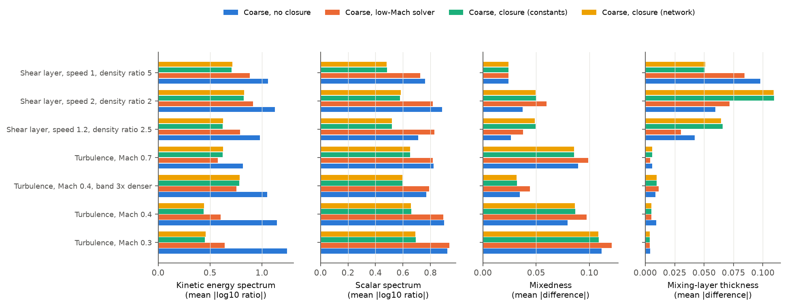

Against the run without it, over the seven cases:

| Measure | Closer to the reference in | Mean error, closure / none |
|---|---|---|
| Kinetic energy spectrum | 7 of 7 | 0.60 |
| Kinetic energy at k = 16-32 | 7 of 7 | (0.20 of the reference's energy becomes 0.36) |
| Scalar spectrum | 7 of 7 | 0.72 |
| Mixedness | 3 of 7 | 1.08 |
| Mixing-layer thickness | 4 of 7 | 1.09 |
| Growth rate of the thickness | 3 of 7 | 1.35 (mean error 0.017 becomes 0.023) |

So the first success criterion is met for the spectra and **not** for the mixing layers. The
closure keeps more small eddies, and they stir: in two of the three shear layers the layer
then grows wider than the reference's, where without the closure it was nearer. In the third
(density ratio 5) the coarse run's layer stops growing at t = 1.5 and the closure's keeps up
with the reference. These are single runs of a chaotic flow, and three of them are too few to
say more than that the closure does not reliably help here.

Against the low-Mach solver, which costs nothing: the closure's kinetic energy spectrum is
better in five of seven, its scalar spectrum in seven of seven (the low-Mach solver does
nothing for the scalar), its thickness in two of seven.

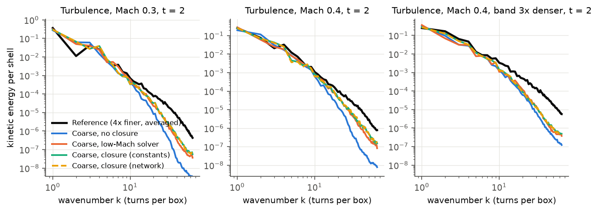
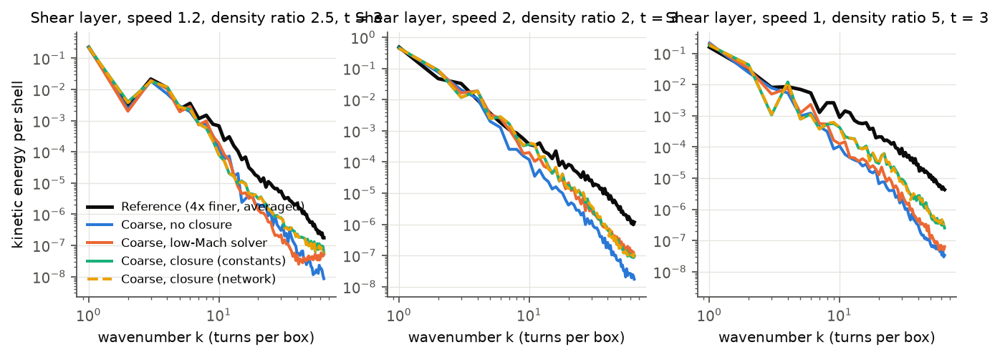
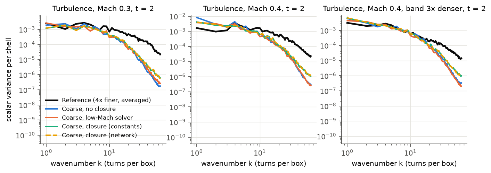
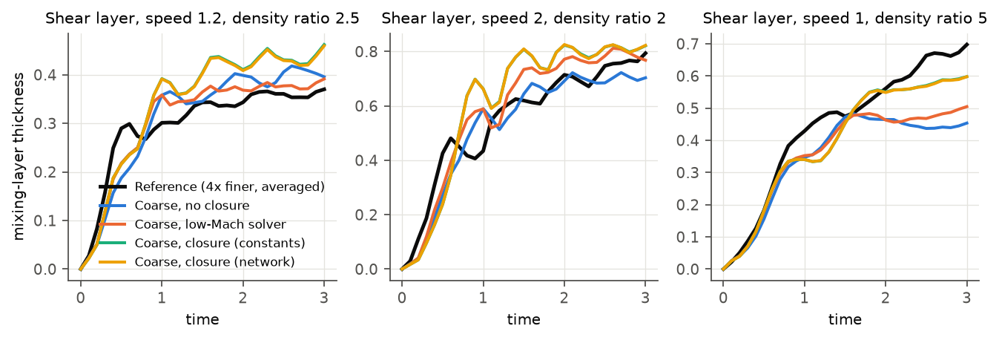
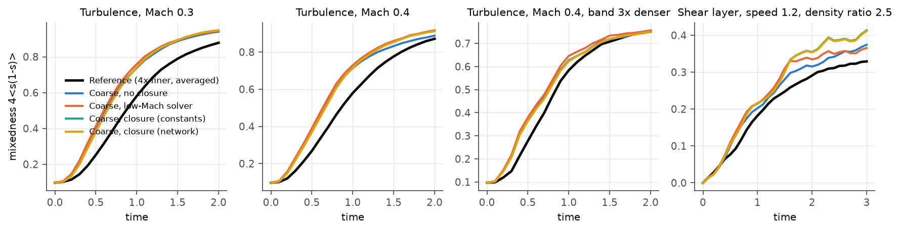
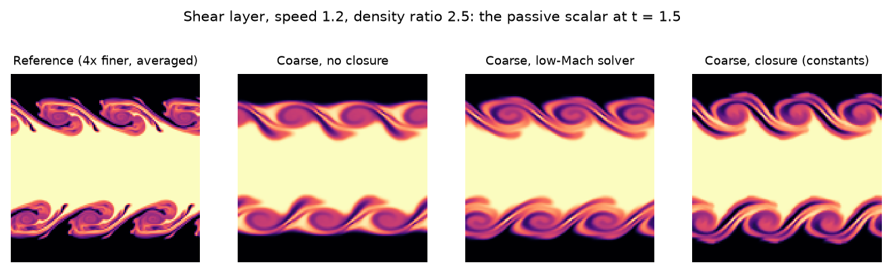
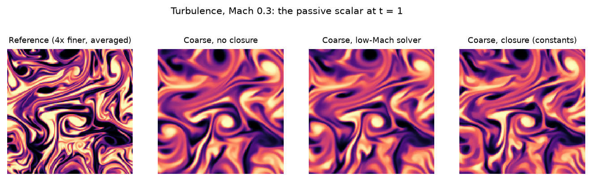

**Another resolution.** The same two cases on 256² against 1024², with the weights trained at
128²: the spectra improve as they do at 128², the shear layer's thickness and mixedness are
again worse.

| Case | Run | KE spectrum | Scalar spectrum | Mixedness | Thickness |
|---|---|---|---|---|---|
| Turbulence, Mach 0.3, 256² | none | 1.50 | 1.06 | 0.120 | 0.003 |
|  | low-Mach solver | 0.89 | 1.09 | 0.126 | 0.003 |
|  | closure | **0.68** | **0.71** | **0.107** | 0.003 |
| Shear layer, speed 1.2, density ratio 2.5, 256² | none | 1.46 | 0.97 | **0.035** | **0.064** |
|  | low-Mach solver | 1.12 | 0.93 | 0.039 | 0.071 |
|  | closure | **0.95** | **0.67** | 0.048 | 0.075 |

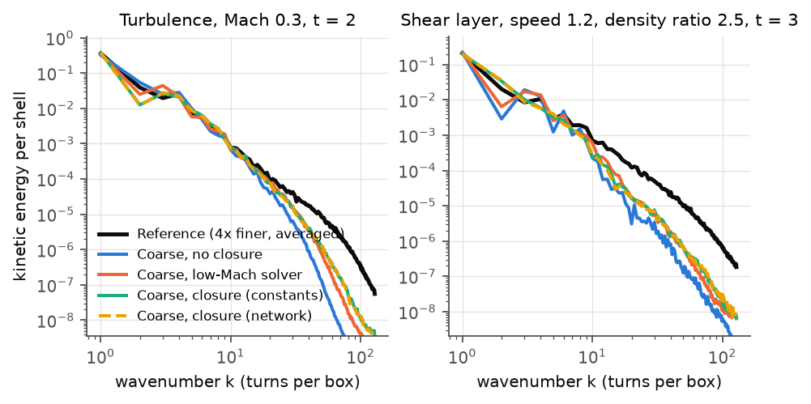

(No coarser case: the simulator's 2D grids start at 128 cells a side.)

**What the network contributes: nothing measurable.** The trained network's outputs, where its
gates are open, are 0.994 of the limit of $`a`$ (least 0.94 in any cell examined) and 0.999 of
the limit of $`b`$, in turbulence and shear layers alike, at every time. The limits are set by
stability (a fifth of the solver's damping must stay) and by the scalar's bound, not by the
data; the data says only "as much as is allowed". So the closure has a second form with no
network: $`a = 0.8`$ and $`b = 0.9`$ times the gates. In the simulator, mean errors over the
seven held-out cases (and the two at 256²):

| Run | KE spectrum | Scalar spectrum | Mixedness | Thickness |
|---|---|---|---|---|
| none | 1.060 (1.478) | 0.825 (1.018) | 0.058 (0.078) | 0.033 (0.034) |
| low-Mach solver | 0.737 (1.002) | 0.830 (1.008) | 0.069 (0.083) | 0.030 (0.037) |
| closure, constants | 0.636 (0.807) | 0.597 (0.691) | 0.062 (0.078) | 0.036 (0.038) |
| closure, trained network | 0.641 (0.814) | 0.597 (0.692) | 0.062 (0.078) | 0.036 (0.039) |

Case by case the two differ by at most 0.01 in the spectra and 0.002 in mixedness and
thickness. The variants trained with the eddy viscosity and diffusivity alone, run in the
solver's mirror from the reference's first state, are the run without a closure:

| Case | Run | KE spectrum | Scalar spectrum | Mixedness | Thickness |
|---|---|---|---|---|---|
| Turbulence, Mach 0.4 | none | 1.17 | 0.91 | 0.079 | 0.009 |
|  | eddy viscosity and diffusivity, trained | 1.17 | 0.92 | 0.079 | 0.009 |
| Shear layer, speed 1, density ratio 5 | none | 1.06 | 0.76 | 0.024 | 0.098 |
|  | eddy viscosity and diffusivity, trained | 1.06 | 0.76 | 0.024 | 0.098 |
| Shear layer, speed 1.2, density ratio 2.5 | none | 0.98 | 0.71 | 0.027 | 0.042 |
|  | eddy viscosity and diffusivity, trained | 0.98 | 0.71 | 0.027 | 0.042 |

## 5. Stability

| Run on 128², to t = 30 | Steps | Mass drift | Energy drift | Kinetic energy | Largest Mach | Scalar range |
|---|---|---|---|---|---|---|
| Decaying turbulence, no closure | 42,482 | 1.2e-7 | 3.6e-7 | 0.500 to 0.400 | 0.78 | -0.0007 to 1.0008 |
| Decaying turbulence, closure | 43,733 | 1.2e-7 | 3.4e-7 | 0.500 to 0.425 | 0.81 | -0.0003 to 1.0008 |
| Kelvin-Helmholtz, no closure | 21,632 | 0 | 3.7e-8 | 0.188 to 0.160 | 0.78 | -0.0012 to 1.0010 |
| Kelvin-Helmholtz, closure | 21,564 | 0 | 2.3e-9 | 0.188 to 0.161 | 0.75 | -0.0009 to 1.0005 |
| Decaying turbulence, constants | 43,615 | 6e-8 | 2.9e-7 | 0.500 to 0.427 | 0.80 | -0.0003 to 1.0008 |
| Kelvin-Helmholtz, constants | 21,996 | 7.9e-8 | 3.7e-8 | 0.188 to 0.166 | 0.77 | -0.0010 to 1.0005 |

The training window is at most 150 steps, so these are 290 and 140 times it. Nothing grows:
the kinetic energy decays throughout, more slowly with the closure, and no cell reaches a
floor. Over the held-out runs of section 4 mass, momentum, energy and scalar mass drift by at
most 5e-8.

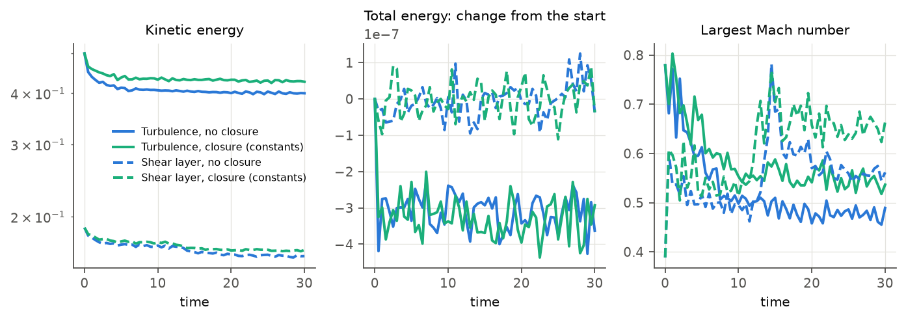

## 6. Shocks

Closure on against off, in the simulator on 256², as the largest change of the density over
its peak (the same with the constants as with the network, to the digits shown):

| Problem | Largest change | Note |
|---|---|---|
| Sod shock tube | 1.9e-6 | L1 error against the exact solution 0.00206 either way |
| Strong shock tube (pressure ratio 1e5) | 5.5e-6 | |
| Sedov blast | 1.7e-4 | The gate opens in a few cells of the staircase of the front |

The first two are rounding: the gates are shut in every cell, and the difference is that of
two differently compiled shaders. For shocks oblique to the grid the solver's mirror was used,
in a periodic box where the waves stay planar (in the simulator an oblique tube meets the
box's open faces, which bend its waves into flow that is sheared in fact): Sod tubes along
(1,0) and (1,1) change by 1e-15, along (2,1), (3,1) and (3,2) by 2e-4 to 3e-4, the same with
the trained network as with the largest coefficients it could ever give.

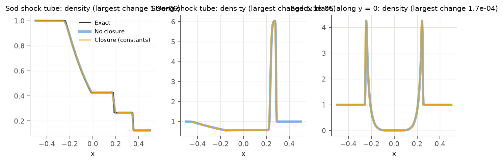

The gates are also what limits the closure at high Mach number: in the Mach 0.7 turbulence
they are open in 30 to 60% of the gas, against 70 to 80% at Mach 0.4.

## 7. Cost

Wall time per step in the simulator (Apple M4 Pro, Chrome, decaying turbulence; the least of
three or four runs):

| Grid | No closure | Constants | More | Trained network | More |
|---|---|---|---|---|---|
| 512² | 0.59 ms | 0.71 ms | 21% | 0.88 ms | 49% |
| 1024² | 1.96 ms | 2.33 ms | 19% | 2.91 ms | 48% |
| 2048² | 7.26 ms | 8.72 ms | 20% | 10.96 ms | 51% |

For scale, a constant viscosity (`nu`) adds 41 to 45% at 1024² and 2048², and the low-Mach
solver nothing. Neither closure is negligible, as was asked; the constants are the cheaper by
more than half. With the network, nearly all of the cost is the network itself: on 1024² its
pass takes 0.83 ms of GPU time and the hook in the flux update 0.15 ms. (Packing the weights
four to a vector and writing them into the shader as constants took the pass from 1.12 to
0.83 ms; a network with 16 units a layer trained to the same losses and would take about half
the time.) With the constants what is left is the gates' pass (five cells loaded per cell)
and the hook, two more loads per face and the scalar's bound.

The alternative to a closure is a finer grid: twice the resolution costs eight times as much
in 2D.

## 8. Limits, and what was left out

- **Not a physical closure.** It corrects this scheme's numerical dissipation at these
  resolutions. A model of unresolved eddies would need a base scheme whose own dissipation is
  below the model's, an explicit filter wider than the grid, three dimensions (in two, energy
  cascades to large scales), and a reference with physical viscosity.
- **Two dimensions, by training and by code.** The pass, the features and the hook are 2D.
  *Three dimensions*: the features generalize as written (divergence, rotation and strain are
  already defined as in 3D; two more neighbors), the hook is dimension-free, and the data would
  be 3D runs at 2 to 4 times the resolution. The physics changes (a forward cascade), so the
  weights would not carry over, and the cost of the pass matters more.
- **MHD.** The MHD passes have their own fluxes (`mhd/flux.wgsl`, HLLD). The same scaling of
  the velocity's jump applies; the field's jump would need its own coefficient and its own
  safeguard, since reducing the dissipation of the field touches the constrained transport's
  consistency. Not attempted.
- **Adaptive mesh.** The block update shares `hydro/flux.wgsl`, so the hook is there; what is
  missing is the pass on the atlas (ghost cells are available) and matching at refinement
  boundaries, where the coarse cell recomputes fine fluxes and must use the fine cells'
  coefficients. Training would need references restricted per level.
- **Self-gravity.** Nothing in the closure knows of gravity. With the well-balanced
  reconstruction the pressure's jump is not scaled, so hydrostatic balance is untouched; the
  activity gate would keep it shut in a star at rest. Untested.
- **Species.** Only the passive scalar is treated; species are advected as before.
- **Mach numbers.** Trained (and the constants' limits chosen) at Mach 0.2 to 0.5, tested to 0.7. Below Mach 0.1 the bound on
  $`a`$ rests on one test of this scheme (the Gresho vortex) and was not re-examined.

## 9. Precedent

Leaving out part of an upwind flux's dissipation of velocity jumps in turbulence, and keeping
all of it at shocks by a sensor, is established practice; what is particular here is the
combination (one constant for the velocity's jump and one for the scalar's, three gates, the
limiter's bound on the scalar) and that the constants were arrived at by training a network
that could have chosen otherwise.

- Scaling the velocity jump shown to the Riemann solver: [Thornber et al. (2008)](https://doi.org/10.1016/j.jcp.2008.01.036),
  by the local Mach number (Shaderous's `hllclm`). The closure is that form with a constant
  factor behind gates.
- [Li (2016)](https://arxiv.org/abs/1509.02777) splits the Roe flux into parts and finds that
  the velocity-difference parts dissipate far more than a sub-grid model would, so that the
  scheme cannot give a turbulence spectrum on a coarse grid until they are reduced: the
  finding of section 1, for another solver. [Li & Gu (2013)](https://arxiv.org/abs/1107.3744)
  and [their HLL version](https://arxiv.org/abs/1111.4885) multiply the velocity-difference
  term by a function of the local Mach number; [Gogoi & Mandal (2023)](https://arxiv.org/abs/2308.09439)
  reconstruct the interface velocities with the face's Mach number and treat shocks apart.
- Sensors that keep full dissipation where the flow is compressive and little where it is
  vortical: [Chamarthi, Hoffmann & Frankel (2023)](https://arxiv.org/abs/2305.08369) and
  [Chamarthi (2026)](https://arxiv.org/abs/2604.02757), with a Ducros-type sensor, as the
  compression gate here. [Deng et al. (2020)](https://arxiv.org/abs/2007.07397) give one
  tunable parameter between an upwind-biased and a non-dissipative scheme, for implicit LES.
- Learning the dissipation instead of a viscosity: [Beck & Kurz (2023)](https://arxiv.org/abs/2309.06260)
  learn a blending of a more and a less dissipative discretization as an implicit closure;
  [Maulik, San & Jacob (2019)](https://arxiv.org/abs/1901.09329) learn, in 2D turbulence, where
  to use an upwind flux and where a non-dissipative one.

## 10. Reproducing this

`tools/closure/README.md` has the commands, from the reference data to the figures. The
validation suite's `closure` test checks, on the GPU, for the constants and for the network,
that the shader is its float64 mirror (to 2e-3 in every cell; it is 1e-5), that both cells of every face compute the same flux with
it on, conservation, and the shock tube and blast above.
