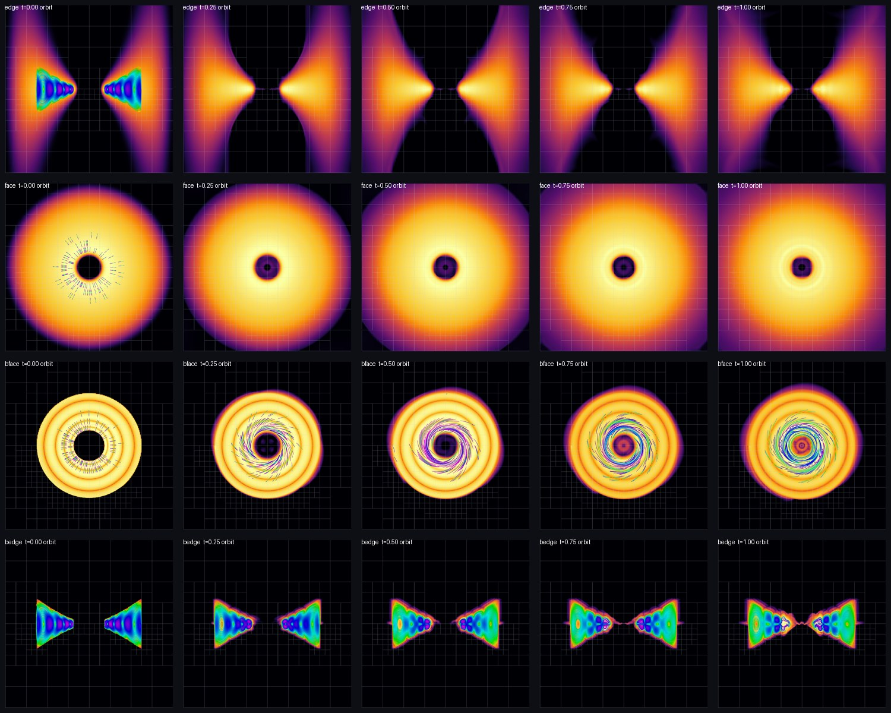

# Headless runs: command line and MCP server

There are two tools for running Shaderous without anyone watching the page. Both are in
[tools/headless](../tools/headless), and both are built on the page's
[scripting API](api.md):

- **The command-line runner** ([cli.mjs](../tools/headless/cli.mjs)) runs a setup or a
  parameter sweep to completion. It writes diagnostics, images, slices and `.athdf` files to a
  folder. Use it for batch work: production runs, convergence studies, figures, CI.
- **The MCP server** ([mcp.mjs](../tools/headless/mcp.mjs)) gives an AI agent the simulator
  as a set of tools. The agent loads a setup, steps it, reads numbers back and looks at
  screenshots, all within one conversation. Use it for exploring.

Both work the same way. They serve the page themselves (this checkout with Vite, or the built
page when installed from npm, as `npx shaderous`), or use a URL you give. They open
the page in Chrome with WebGPU, headless by default, and call `window.shaderous`. Nothing has to
be running beforehand.

**Contents**

1. [Requirements](#requirements)
2. [Command-line runner](#command-line-runner)
3. [MCP server](#mcp-server)
4. [Cloud GPUs and Linux servers](#cloud-gpus-and-linux-servers), and the largest run so far
5. [Troubleshooting](#troubleshooting)

---

## Requirements

- Node 20 or later. Either `npm install` in a checkout, or nothing: `npx -y shaderous ...`
  fetches the npm package, which carries the built page and runs the same commands
  (`npx shaderous run ...`, `npx shaderous mcp`). `SHADEROUS_SERVE=dist` makes a checkout serve
  its `dist/` (after `npm run build`) as the package does.
- Google Chrome. Set `PW_CHANNEL=msedge` to use Edge. Playwright drives the installed browser,
  so it doesn't need to download one.
- A GPU that Chrome will use for WebGPU. On a machine without one, Chrome may fall back to a
  software adapter, which works but is very slow. `state` and the run manifest name the
  adapter, so you can tell which one you got.

`npm run test:headless` checks the whole chain on your machine. It drives the MCP server
through a short conversation, then runs the command-line runner, and reports each check.

## Command-line runner

```bash
npm run headless -- <command> [setup] [options]
```

`node tools/headless/cli.mjs <command> ...` does the same. `--help` lists every option.

### Commands

- **`run`** runs one setup and writes its outputs to a folder.
- **`sweep`** runs a setup once for every combination of `--vary` values.
- **`describe [problem]`** prints the problems, fields and choices as JSON, or one problem's
  full entry.

### The setup

A setup uses the keys of a shareable link (see [api.md](api.md#setups)). It can be given as a
query string or link, as flags, or both:

```bash
npm run headless -- run "problem=sedov&dim=3&n=128&amr=2" --until 0.05
```

```bash
npm run headless -- run --problem sedov --dim 3 --n 128 --amr 2 --set gamma=1.4 --until 0.05
```

`--set KEY=VALUE` takes any setup key and can be repeated. That includes a problem's own
parameters, as `p.<id>`.

`--setup FILE` builds the run from a setup document instead of a preset: a preset's own file
(`src/presets/binary.json`), or one saved from the Setup dialog or written by hand
([setups.md](setups.md)). The other setup flags then say the grid and what differs from the
file:

```
npm run headless -- run --setup my-triple.shaderous.json --dim 3 --n 256 --amr 2 --until 10 --every 1 --png --out runs/triple
```

A document whose obstacles are mesh files (a `mesh` shape, [setups.md](setups.md)) names
them; the runner reads each from the document's folder and gives it to the page before the
run is built (a `.gltf`'s separate buffers too). A URL is fetched by the page.

The MCP server's `check_setup` tool reads a document without running it and returns what is
wrong with it or worth a second look (`check` in [api.md](api.md)). The MCP server's `load` tool takes the same thing as `document`, and its `describe` tool with
a `problem` returns that preset's document to start from. Both read a document's mesh files
from `dir` (default: the server's working folder).

### When to stop

- `--until T` runs to time T. The last step is shortened so that the run lands on T exactly.
- `--steps N` takes at most N steps.
- With neither, the run goes to the problem's end time.
- `--every DT` writes outputs at t = 0 and every DT after it. Output times are exact multiples
  of DT, so outputs line up across runs with different timesteps.
- `--timeout SECONDS` stops a run that is taking too long.
- `--every-wall SECONDS` writes outputs at the start and every SECONDS of wall time after it,
  in place of `--every`: for a run whose pace is not known in advance.
- `--wall SECONDS` is a budget of wall time for the whole run, loading included. When it is
  spent the run stops and writes its last outputs (with `--athdf-every`, a checkpoint), so
  leave room for them; the manifest says `"stopped": "wall"`. With `--wall` a run needs no
  `--until`. A file named `STOP` put in the output folder stops the run the same way at its
  next output (`"stopped": "stop-file"`).

### Outputs

Each run writes a folder, `--out DIR`, which defaults to `runs/<problem>-<date>`.

| File | Contents |
| --- | --- |
| `manifest.json` | The setup in force (`setup`, a query string that reproduces the run), view settings, build, GPU adapter, the command line, start and end time, why the run stopped, the files of each output, and any errors the page reported |
| `diag.jsonl` | One line of diagnostics per output: time, steps, wall time, the adaptive mesh's `mesh` line (blocks, and whether the budget is full), mass, momentum, energies, Mach number, point masses, field ranges, and the magnetic and radiation totals of a run that has them (all of `diagnostics()` in [api.md](api.md#reference)). With radiation transport, the light curve between two outputs is the change of `radiation.escaped` over the change of `radiation.escapedAt` |
| `NNNN-tT.png` | A screenshot at each output, with `--png`. Set the size with `--width` and `--height`, and what is drawn with `--view KEY=VALUE`. With `--native` instead of a size, a plane (a 2D run, a slice or a projection) at the grid's own resolution, one pixel per cell of the finest level, with the color bar, axes and status line beside it (`screenshot({ native })` in [api.md](api.md#reference)) |
| `NNNN-tT-NAME.png` | A screenshot of each `--shot NAME:KEY=VALUE,..` at each output: the `--view` settings with the shot's on top (the same keys, comma-separated), so that each output can show several views. Each shot starts again from the `--view` settings and the colormap they leave, so one shot's settings do not carry into the next |
| `NNNN-tT-VAR.json` | A slice of variable VAR at each output, with `--slice VAR` (repeatable). Set it with `--slice-axis`, `--slice-pos` and `--slice-res`; the format is that of `slice()` in [api.md](api.md#reference) |
| `NNNN-tT-VAR.npy` | The same slice with `--slice-format npy`, as a file numpy reads: float32 of shape `[res, res]`, row `j` and column `i` as in `slice()`. The slice's other fields (`t`, `variable`, `axis`, `pos`, `res`, `axes`, `min`, `max`) are in `manifest.json`, under that output's `slices` |
| `NNNN-tT.athdf` | The state of the gas at each output, with `--athdf`, or at every Nth output and the last with `--athdf-every N` (0: the last only; a run resumed with `--from` skips output 0, the file it started from). yt and Athena++'s tools read these, and the page or `load_athdf` can continue the run from them. They are read out of the page 64 MB at a time, so files of gigabytes come out whole |
| `movie.mp4` | The whole run as a movie, with `--mp4`: a frame near every `--frame-dt DT` of simulated time (default a 600th of the problem's dynamical time) or every `--frame-every N` steps, played at `--fps` (default 60), at `--bitrate` megabits per second (default 0.2 bits per pixel per frame), at `--width` x `--height` (default 1920 x 1080), with a color bar, axes and the status line unless `--no-overlays`. `manifest.json` gets a `movie` entry with its frame count and length. Not with `--every` or `--steps`; outputs are then written at the start and the end only |
| `NNNN-tT-debris.json` | Debris energies and the return rate dM/dt at each output, with `--debris`, for problems that track them (the tidal disruption). The format is that of `debris()` in [api.md](api.md#reference) |

A `--view` setting is any key of `view()` in [api.md](api.md#reference), such as
`--view mode=slice`, `--view field=pressure` (a field by name or index), `--view colormap=viridis`
or `--view log=false`.

The process exits with 0 on success, 1 on an error, and 2 if the page reported an error during
the run. In that last case the run's outputs are still written, and the errors are listed in
`manifest.json`.

### Examples

A 2D Kelvin-Helmholtz run, with a picture of the passive scalar every 0.25 time units:

```bash
npm run headless -- run --problem kelvin-helmholtz --dim 2 --n 1024 --until 2 --every 0.25 --png --view field=2 --out runs/kh
```

A convergence study of the Sedov blast, keeping density slices to compare:

```bash
npm run headless -- sweep --problem sedov --dim 2 --vary n=128,256,512,1024 --until 0.05 --slice rho --slice-res 512 --out runs/sedov-convergence
```

The same slices as `.npy` files, which numpy reads directly:

```bash
npm run headless -- run --problem sedov --dim 2 --n 1024 --until 0.05 --every 0.01 --slice rho --slice-res 1024 --slice-format npy --out runs/sedov-npy
```

```python
import json, numpy as np
run = 'runs/sedov-npy'
for out in json.load(open(f'{run}/manifest.json'))['outputs']:
    for s in out.get('slices', []):
        rho = np.load(f"{run}/{s['file']}")  # rho[j, i]: i along axes[0], j along axes[1]
        print(s['t'], s['variable'], rho.shape, rho.max())
```

A sweep writes one folder per combination, named after its values (`n=256/`, or
`gamma=1.4,cfl=0.3/` for two keys). It also writes `sweep.jsonl`, with one line per run: the
values, the setup in force, the final time and steps, why the run stopped, and the wall time.

A long 3D run, at low priority so the machine stays responsive, with checkpoints:

```bash
npm run headless -- run --problem tidal-disruption-full --dim 3 --n 512 --amr 4 --every 0.5 --athdf --low-priority --out runs/tde
```

A run held to four hours on a rented GPU: a volume rendering with field lines and a density
slice every ten minutes, a checkpoint every hour, and the last state when the time is up:

```bash
npm run headless -- run --setup examples/setups/rlof-stars-random-field.shaderous.json --n 1024 --amr 4 --wall 14100 --every-wall 600 --athdf-every 6 --shot vol:mode=volume,showBlocks=false,fieldLines=true --shot rho:mode=slice,sliceAxis=2,showBlocks=false --overlays --gpu-memory 80 --out runs/rlof
```

A tidal disruption's return rate, the classic dM/dt diagram. Run a few dynamical times past
pericenter with `--debris`, then plot the last output:

```bash
npm run headless -- run --problem tidal-disruption-full --until 20 --every 1 --debris --low-priority --out runs/tde
```

```bash
python tools/headless/plot_dmdt.py runs/tde
```

The plot shows dM/dε, split into what has left the box and what is still in it, and dM/dt
against time since pericenter. It uses solar masses per year and years where the problem has
units. Give it several outputs (`runs/tde/*-debris.json`) to see whether dM/dt has stopped
changing. It needs numpy and matplotlib.

### Options

Every option, as `--help` prints them (this table is written from the runner's own table of
flags, [flags.mjs](../tools/headless/flags.mjs), by `npm run gen`):

<!-- gen:cli-options -->
**Setup (the same keys as a shared link; see docs/api.md)**

| Option | Meaning |
| --- | --- |
| `--problem ID`, `--dim 2\|3`, `--n CELLS`, `--amr LEVELS` | The preset, and its grid |
| `--set KEY=VALUE` | Any other setup key, repeatable: --set gamma=1.4 --set p.mach=3 |
| `--setup FILE` | A setup document (name.shaderous.json, see docs/setups.md) in place of --problem: a preset's file, or one saved from the Setup dialog. The keys above then say the grid and what differs from the file |
| `--from FILE` | Carry on from an .athdf file the runner, the page or save_athdf wrote, at its time, with its settings: no setup keys, --setup or --vary. Times (--until, output times) are the run's own, so --until is where it ends |

**Stopping (default: the problem's end time)**

| Option | Meaning |
| --- | --- |
| `--until T` | Run to this time (landed on exactly) |
| `--steps N` | Run at most this many steps |
| `--every DT` | Write outputs every DT of simulated time (and at the start) |
| `--every-wall SECONDS` | Or write outputs every SECONDS of wall time (and at the start) |
| `--timeout SECONDS` | Give up on a run after this much wall time |
| `--wall SECONDS` | Stop after this much wall time in all (loading included), and write the last outputs then. A file named STOP in the output folder stops the run the same way at its next output |

**Outputs (diag.jsonl and manifest.json are always written)**

| Option | Meaning |
| --- | --- |
| `--out DIR` | Folder (default: runs/<problem>-<date>) |
| `--png` | A screenshot at each output |
| `--width PX`, `--height PX` | Screenshot size (default 1024 square) |
| `--overlays` | The color bar, axes and status line (with the time) on each screenshot |
| `--native` | Screenshots at the grid's own resolution (a plane: a 2D run, a slice or a projection): one pixel per cell of the finest level, with the color bar, axes and status line beside it. Not with --width or --height |
| `--view KEY=VALUE` | View setting for screenshots, repeatable: --view field=3 --view colormap=viridis |
| `--shot NAME:KEY=VALUE,..` | A screenshot of its own at each output, NNNN-tT-NAME.png: the --view settings with these on top. Repeatable, one per view: --shot vol:mode=volume --shot rho:mode=slice,sliceAxis=2 |
| `--slice VAR` | A slice of this variable at each output (repeatable) |
| `--slice-axis A`, `--slice-pos P`, `--slice-res R` | Its axis (0 to 2), position (0 to 1) and cells per side |
| `--slice-format F` | json (default): NNNN-tT-VAR.json, the whole slice() result; or npy: NNNN-tT-VAR.npy, float32 of shape [res, res] for numpy's np.load, with the slice's other fields under that output's "slices" in manifest.json |
| `--athdf` | An .athdf file at each output |
| `--athdf-every N` | Or an .athdf file every Nth output and at the last (0: the last only; a --from run skips its first) |
| `--debris` | Debris energies and dM/dt at each output, as JSON (problems that track them, such as tidal-disruption); plot with tools/headless/plot_dmdt.py |

**Movie (--mp4 records the whole run as movie.mp4, with a color bar, axes and the status line; not with --every or --steps; outputs are written at the start and the end)**

| Option | Meaning |
| --- | --- |
| `--mp4` | Record the run as an MP4 movie |
| `--frame-dt DT` | A frame near every DT of simulated time (no step is shortened for it); default a 600th of the problem's dynamical time |
| `--frame-every N` | Or a frame every N steps |
| `--fps F` | Playback rate (default 60) |
| `--bitrate M` | Megabits per second of movie (default 0.2 bits per pixel per frame: 25 at 1080p and 60 fps) |
| `--no-overlays` | Leave out the color bar, the axes and the status line |

**Sweeps**

| Option | Meaning |
| --- | --- |
| `--vary KEY=V1,V2,..` | Values of a setup key, repeatable; every combination is run |

**Other**

| Option | Meaning |
| --- | --- |
| `--url URL` | Use the page served here (default: serve this checkout with Vite) |
| `--headed` | Show the browser (if headless Chrome finds no GPU adapter) |
| `--low-priority` | Run at below-normal CPU priority (the browser inherits it on Windows) |
| `--gpu-memory GB` | GPU memory the simulation may take (the panel's setting; default 2.5 on a desktop): how many blocks the adaptive mesh can hold |
| `--quiet` | No progress messages |
<!-- /gen:cli-options -->

Each run starts a fresh browser profile with the guessed default of `--gpu-memory` (2.5 GB on a
desktop), so a big adaptive run on a large GPU wants it set.

## MCP server

The server speaks the [Model Context Protocol](https://modelcontextprotocol.io) over stdio. It
uses no libraries beyond those the project already has. It opens one simulator page on the first
tool call and keeps it until the client disconnects.

### Connecting

For Claude Code, the plugin in [plugins/shaderous](../plugins/shaderous) adds the server
(through npx) and a skill for running it and building setups:
`claude plugin marketplace add guillochon/shaderous`, then
`claude plugin install shaderous@shaderous`.

From the npm package, with no checkout, the command is `npx -y shaderous mcp`:

```bash
claude mcp add shaderous -- npx -y shaderous mcp
```

```json
{ "mcpServers": { "shaderous": { "command": "npx", "args": ["-y", "shaderous", "mcp"] } } }
```

### Releases

1. Add a section `## X.Y.Z (YYYY-MM-DD)` to [CHANGELOG.md](../CHANGELOG.md), above the last
   release's, saying what was added, changed and fixed (`git log vA.B.C..HEAD` lists what went
   in). `node tools/changelog.mjs X.Y.Z` prints it back.
2. `node tools/version.mjs X.Y.Z` sets the version in package.json, server.json and the plugin's
   manifest, and says so if the changelog has no section for it.
3. Commit, then push the tag `vX.Y.Z`.

The [release workflow](../.github/workflows/npm.yml) checks that the versions agree with the
tag and that the changelog has the version, publishes the npm package (CHANGELOG.md is in it),
creates the [GitHub release](https://github.com/guillochon/shaderous/releases) with the
changelog's section as its notes, and updates the MCP Registry listing.

The server is listed in the [MCP Registry](https://registry.modelcontextprotocol.io) as
`io.github.guillochon/shaderous` ([server.json](../server.json)); clients that browse the
registry install it from there.

In a checkout, [.mcp.json](../.mcp.json) at the repository root registers the server for
Claude Code in this project. Claude Code asks you to approve it the first time. For another
client, or from elsewhere, give the command with an absolute path:

```json
{
  "mcpServers": {
    "shaderous": {
      "command": "node",
      "args": ["/path/to/shaderous/tools/headless/mcp.mjs"]
    }
  }
}
```

With Claude Code you can also run
`claude mcp add shaderous -- node /path/to/shaderous/tools/headless/mcp.mjs`.

The server accepts `--url URL`, `--headed`, `--low-priority` and `--gpu-memory GB`, which mean
the same as for the runner. Mid-session, the `control` tool sets the GPU memory too:
`control {id: "gpumem", value: 4}` (in GB; it starts the run again), and `value: ""` returns to the
guessed default.

### Tools

<!-- gen:mcp-tools -->
| Tool | What it does |
| --- | --- |
| `describe` | Lists problems (id, dimensions, end time, parameters), fields, variables and choices. Give `problem` for one problem’s full entry, with its setup document |
| `check_setup` | Checks a setup document without running it: whether it can be read, what reading left out, and the errors and warnings the Setup dialog would list |
| `load` | Builds a run from a setup (query string or object) or a setup document, paused at t = 0 |
| `run` | Advances to a time (`until`, landed on exactly), by a number of `steps`, or whichever comes first, with an optional `timeout_seconds` |
| `state` | Returns the problem, grid, time, steps, end time, GPU adapter, and `query`, the setup in force |
| `diagnostics` | Reads back totals and extremes: mass, momentum, energies, Mach number, point masses, field ranges |
| `stats` | Gives each variable’s min, max and volume-weighted mean over the box |
| `slice` | Samples a variable on a plane. Returns min, max and mean, with the values as rows when `res` is at most 64; `save_path` writes the full slice to a file instead: a `.npy` file (float32, shape `[res, res]`) if the name ends in `.npy`, else JSON |
| `probe` | Gives the gas at given points |
| `screenshot` | Returns a PNG image of the view, optionally changing the `view` first and saving to `save_path` |
| `view` | Changes what screenshots show, leaving the run alone |
| `controls` | Lists the panel’s controls and the settings of the option table that can change mid-run |
| `control` | Sets one of them (or presses a button) mid-run, as a person would |
| `restart` | Starts again from the initial conditions |
| `save_athdf` | Writes the state of the gas to an `.athdf` file |
| `record` | Records the run from where it is as an MP4 movie to `path`, with a color bar, axes and the status line (with the simulation time): a frame every `every` steps or near every `dt` of code time, until `until` or `frames` |
| `load_athdf` | Starts a run from an `.athdf` file, or opens it for viewing only |
| `debris` | Gives debris energies and the return rate dM/dt, for problems that track them: totals, the surviving core, the first return and the peak. `save_path` writes the full report |
| `impact` | Gives what a giant impact has left: the masses of the planet, the disk around it and the escaping gas, what each is made of, and the moon the disk would gather into |
| `edit` | Uses an editing tool on the run, as a person would: `name` (mass, velocity, temperature, obstacle, field, pull, source, sink, star, clear, query) and its `options` |
| `session_log` | Summarizes what has been done to the run since it started (actions by kind, steps), and writes the full session log to `save_path` |
| `replay` | Runs a saved session log (a file written by session_log or the page’s Save session log button) again, step for step |
| `errors` | Lists what the page has reported going wrong |
<!-- /gen:mcp-tools -->

File paths are relative to the server's working directory, which for Claude Code is the
project root. A tool that fails returns its error message as a tool error, with `isError` set,
so the model can correct its call.

## Cloud GPUs and Linux servers

The runner works on a rented GPU (a Runpod pod, for example) as it does on a desktop. On
Linux it passes `--use-angle=vulkan --enable-features=Vulkan --disable-vulkan-surface` to
Chrome; without the last, headless Chrome's GPU process crashes and WebGPU falls back to
SwiftShader. What the machine needs:

- The NVIDIA Vulkan driver inside the container: set `NVIDIA_DRIVER_CAPABILITIES=all` on the
  pod or container.
- Node and a browser. The Playwright Docker image (`mcr.microsoft.com/playwright:v<version>-noble`,
  the version in `package-lock.json`) has both, but not Chrome: set `PW_CHANNEL=shell` to use
  Playwright's own headless shell.
- Then `git clone`, `npm ci`, and run as usual. `state` and `manifest.json` should name the
  adapter `nvidia <architecture>`, such as `nvidia lovelace`.
- `--gpu-memory` set to what the card holds, less a few GB for the browser, or the adaptive
  mesh keeps the desktop default of 2.5 GB.
- The largest 3D adaptive mesh with a magnetic field is 35^3 = 42,875 blocks of 16^3 cells,
  about 110 GB in use, set by the field's flux register (one buffer within the 2 GiB a binding
  may have). With species it is 41^3 blocks: their face fluxes fill one buffer of up to 4 GiB,
  bound as two windows of 2 GiB, and the species atlas stacks its groups of four along y as well
  as z once they pass 2048 texels (13 species at 51^3 blocks would fit). Without either, and
  with self-gravity, only the card's memory bounds it: every pass over the blocks is dispatched
  in slabs. Stars are settled into hydrostatic balance on the GPU, so their size does not
  bound the mesh either (on the CPU, a white dwarf at 2048^3 ran out of page memory). An RTX PRO 6000 (96 GB) holds 32^3 blocks; the MRI disk at
  1024^3 with 4 levels ran on an H200 at 35^3 (117 GB, load 23 s, 10 steps in 10 s). At 2048^3
  the blocks run out a level short of the finest. Atlas textures past 4 GiB are made render
  attachments, so WebGPU zero-fills them with a render pass: through a staging buffer, as it
  otherwise does, they would pass the 4 GiB a buffer may be, and they lost the device.
- Data-center Hopper cards (H100, H200): Chrome's compositor loses the Vulkan device on its first
  frame, and WebGPU with it. Set `SHADEROUS_NO_GPU_COMPOSITING=1` to keep Chrome's own drawing
  off the GPU: runs, diagnostics and slices then work (the MRI disk at 2048^3 ran on an H200).
  A WebGPU canvas cannot be read then, so with this switch screenshots and movie frames are
  drawn into a texture of their own and copied back from the GPU, as slices are (the pixels
  match the canvas's exactly on an RTX 3080).

On a cluster with Slurm and Apptainer (no Docker), [tools/headless/slurm](../tools/headless/slurm/README.md)
runs the same image under Apptainer: a check job for the GPU's Vulkan driver, and a long run
split into jobs that each carry on from the last checkpoint (`--from`) and submit the next.

### Largest run so far

The magnetized accretion disk (`mri-disk`) at 512^3 with 3 levels of refinement and
`--gpu-memory 16`, on an RTX 4090 (24 GB) on 2026-11-15. The adaptive mesh had room for
5,832 blocks of 16^3 cells, about 24 million cells, and the run held 16.8 GB of GPU memory
throughout. The load took 90 s, all of it building the initial disk on the CPU in one thread.
That work (sampling the setup for the mesh, the field's edge integrals and each leaf's state)
has since been made several times cheaper and spread over the CPU's cores in workers: the same
setup at the default 2.5 GB restarts in 1.1 s instead of 12.7 s on a 16-thread desktop. The
16 GB load on the pod has not been timed again. One orbit at r = 1 (t = 2π, 6,359 steps)
then took 14 minutes, with the GPU 92 to 98% busy. Over that orbit the magnetic energy grew 5.4 times and the Maxwell
stress reached α = 0.009, as the shear wound the loops into trailing spirals.



The script that took these screenshots (several views at each eighth of an orbit) used the
same session as the runner: `openSession({ gpuMemory: 16 })`, then `load`, `run({ until })`,
`view` and `screenshot` through `call`, as in [the scripting API](api.md).

## Troubleshooting

- **"the simulator did not start: ... WebGPU"**: Chrome found no WebGPU adapter. Try
  `--headed`, and check `chrome://gpu` in a normal window. On Windows the runner already passes
  `--use-angle=d3d11`, which headless Chrome needs there.
- **"could not start Chrome"**: Chrome isn't installed where Playwright looks. Install it, or
  use Edge with `PW_CHANNEL=msedge`.
- **The adapter is SwiftShader on a Linux GPU server or pod**: the container lacks the NVIDIA
  Vulkan driver, or Chrome is not the headless shell. See
  [Cloud GPUs and Linux servers](#cloud-gpus-and-linux-servers).
- **It runs but is very slow**: check `adapter` in `state` or `manifest.json`. A software
  fallback adapter is 100 or more times slower than a GPU.
- **A command line with `&` in the setup misbehaves on Windows**: `cmd` splits commands on `&`.
  Quote the setup, or give it as flags (`--problem sedov --dim 2`).
- **Outputs past the end time are missing**: a run stops at the problem's end time. Pass a later
  one with `--set tend=10`, or `--set tend=inf` for none.
